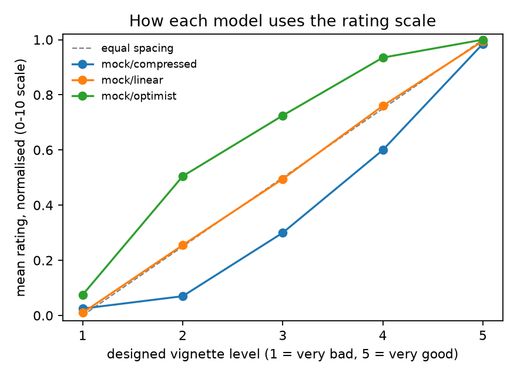

# llm-scale-use

**Do language models use rating scales the way people do, and can their self-reports be compared across models?**

A small, testable pipeline for measuring how LLMs use numerical rating scales, built around three questions from wellbeing measurement:

1. **Cardinality / linear scale use.** When a model rates how well someone's life is going on 0–10, are the categories equally spaced, or is the scale bent? Human wellbeing research mostly assumes equal spacing; Kaiser & Lepinteur (2025) show that small departures from it can flip the sign of published results.
2. **Comparability.** Two models can give different numbers for the same underlying state simply because they use the scale differently. Anchoring vignettes (King et al. 2004; King & Wand 2007) correct for this by having every respondent rate the *same* hypothetical people and then reading self-reports relative to those ratings.
3. **Verbal report vs internal state.** For open-weight models, does the full rating distribution in the logits agree with the sampled verbal answer, and can a linear probe on the residual stream read out the designed valence of a vignette? This follows the truth-classifier approach of Kaiser & Enderby (2026), applied to valence rather than belief.

## Design

- **20 vignettes**: 5 designed valence levels (very bad → very good) × 4 life domains (work, health, relationships, money). Items are in `scaleuse/items.py`.
- **1 self-report item**: "how are things going for you right now?"
- **3 response formats**: 0–10, 1–5, 0–100.
- Fully crossed: model × item × format × repetition. The order is shuffled per model, and runs can be resumed.

| Module | What it does |
|---|---|
| `run_blackbox.py` | Collects ratings via **Ollama** (free, local), **Groq** (free cloud), **OpenRouter**, or a **mock respondent** for offline testing. |
| `analysis.py` | Parse rate, test–retest reliability (ICC(1)), validity (Spearman with a cluster bootstrap over vignettes), scale profile and departure from equal spacing, lack-of-fit F-test, cross-format consistency, King–Wand nonparametric *C*, and a vignette-adjusted self-rating. |
| `whitebox.py` | **Hugging Face transformers.** Gets the exact probability distribution over answers from the logits (multi-token numbers handled correctly) and saves residual-stream activations at every layer. |
| `probe.py` | Layer-wise ridge probes for designed valence, with leave-one-domain-out CV, a permutation test, and an exploratory probe read-out of the self item. |

## Validation on simulated respondents

The analysis was validated offline against three mock respondents whose scale use is known: one linear, one "optimist" that inflates the low end, and one "compressed". All three have **the same** true self-state (3.8 on the 1–5 level scale).

```
python -m scaleuse.run_blackbox --backend mock --reps 5 --out results/mock_ratings.jsonl
python -m scaleuse.analysis results/mock_ratings.jsonl
```

| mock respondent (0–10) | departure from equal spacing | lack-of-fit p | raw self-rating (0–1) | vignette-adjusted self (1–5) |
|---|---|---|---|---|
| linear | 0.007 | 0.50 | 0.74 | 3.93 |
| optimist | 0.199 | <1e-30 | 0.82 | 3.45 |
| compressed | 0.189 | <1e-28 | 0.54 | 3.80 |

The pipeline finds nonlinear scale use where it was planted and not where it wasn't. Raw self-reports differ by 0.28 on the unit scale even though the true state is identical; the vignette adjustment brings them back to within about 0.5 of a level. **These are simulation checks, not findings about real models.**



## Running it on real models

Use a **non-reasoning model**: reasoning models spend their 16-token budget on `<think>` tags rather than the answer. (`parse_rating` strips `<think>` blocks, but a 16-token cap leaves nothing for the number.)

```bash
pip install -r requirements.txt
```

### Black-box (any model with a chat API)

315 short calls per model (21 items × 3 formats × 5 reps).

```bash
# ── Ollama — free, local ─────────────────────────────────────────────────────
ollama pull llama3.2      # ~2 GB; runs on CPU
ollama pull gemma3:4b
ollama pull qwen2.5:3b

python -m scaleuse.run_blackbox --backend ollama \
  --models llama3.2 gemma3:4b qwen2.5:3b \
  --reps 5 --out results/ratings_ollama.jsonl
python -m scaleuse.analysis results/ratings_ollama.jsonl

# ── Groq — free cloud (set GROQ_API_KEY) ────────────────────────────────────
python -m scaleuse.run_blackbox --backend groq \
  --models llama-3.1-8b-instant gemma2-9b-it \
  --reps 5 --out results/ratings_groq.jsonl
python -m scaleuse.analysis results/ratings_groq.jsonl

# ── OpenRouter (set OPENROUTER_API_KEY) ──────────────────────────────────────
python -m scaleuse.run_blackbox --backend openrouter \
  --models openai/gpt-4o-mini meta-llama/llama-3.1-8b-instruct \
  --reps 5 --out results/ratings_openrouter.jsonl
python -m scaleuse.analysis results/ratings_openrouter.jsonl
```

### White-box (open-weight models, Hugging Face)

CPU is fine for 0.5B models; use a GPU (Colab, RunPod, HPC) for 7B+.

```bash
# rate task: logit distributions + residual-stream activations at every layer
python -m scaleuse.whitebox --model Qwen/Qwen2.5-0.5B-Instruct --formats 0-10 1-5

# summarise task: same vignettes, sentence-completion prompt — activations only
# (used to test whether the late-layer probe reads valence or just the next token)
python -m scaleuse.whitebox --model Qwen/Qwen2.5-0.5B-Instruct --task summarise

# probe: layer-wise valence readout; prints probe vs. verbal (logit) side by side
python -m scaleuse.probe results/wb_Qwen2.5-0.5B-Instruct.npz

# transfer: rate / summarise / cross-task rho side by side
python -m scaleuse.probe results/wb_Qwen2.5-0.5B-Instruct.npz --transfer
```

`notebooks/colab_whitebox.ipynb` runs the white-box part on a free Colab GPU.

## Tests

```bash
PYTHONPATH=. python -m pytest -q
```

The tests check rating parsing (including `<think>` block stripping), the balance of the design, ICC on known matrices, that affine rescaling does not count as a departure from linearity, deterministic lack-of-fit edge cases, King–Wand *C* on hand-worked cases, that the vignette adjustment exactly removes a planted scale-use difference, that the mock pipeline recovers known scale use (including resume), that the probe finds a direction planted in one layer, that the permutation test accounts for best-layer selection, the fake-server end-to-end backend test, and that the transfer probe recovers a cross-task direction.

## Limitations and next steps

- **Small item set.** 20 vignettes is enough to test the pipeline but thin for probes in high dimensions. A next step is a larger, validated vignette bank, with designed levels checked against human ratings.
- **Vignette equivalence.** Anchoring vignettes assume models read the vignettes the same way (*vignette equivalence*) and judge them by the same standards as themselves (*response consistency*). Neither assumption is obvious for LLMs, and both can be tested.
- **Third-person to first-person transfer.** A probe trained on vignettes about other people may not measure anything about the model itself. The self read-out is exploratory, and ridge shrinkage pulls it toward the mean.
- **Parametric extensions.** A hierarchical ordered probit (HOPIT) with model-specific thresholds, and the cost-function approach of Kaiser & Lepinteur to ask how much nonlinearity would be needed to overturn a cross-model comparison.
- **Prompt sensitivity.** Persona, system prompt, reasoning on/off and language are all moderators worth crossing in.

## References

- Kaiser, C. & Lepinteur, A. (2025). *Measuring the Unmeasurable? Systematic Evidence on Scale Transformations in Subjective Survey Data.* arXiv:2507.16440.
- Kaiser, C. & Enderby, S. (2026). *No Reliable Evidence of Self-Reported Sentience in Small Large Language Models.* arXiv:2601.15334.
- King, G., Murray, C. J. L., Salomon, J. A. & Tandon, A. (2004). Enhancing the validity and cross-cultural comparability of measurement in survey research. *American Political Science Review*, 98(1).
- King, G. & Wand, J. (2007). Comparing incomparable survey responses: Evaluating and selecting anchoring vignettes. *Political Analysis*, 15(1).

MIT licence.
